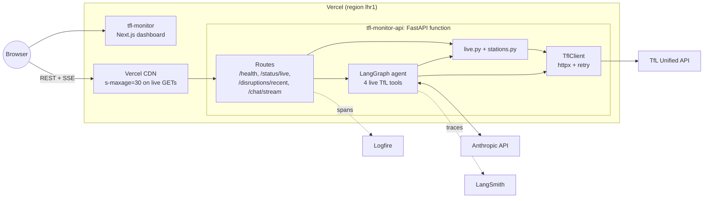
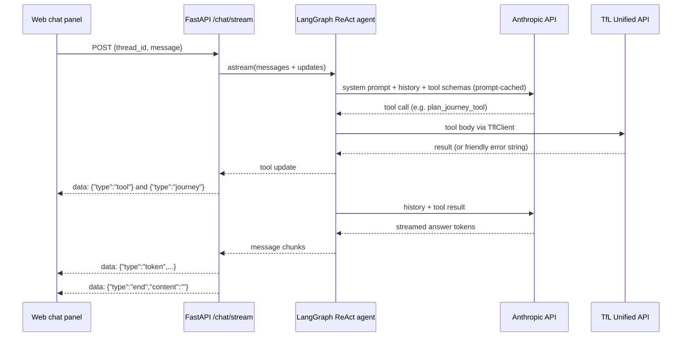

# Architecture

tfl-monitor is a live TfL proxy with a chat agent. A stateless FastAPI
function on Vercel reads the TfL Unified API on demand and hosts a LangGraph
agent whose tools also call TfL live. Nothing is persisted: there is no
database, no broker, and no document store (ADR 014, ADR 015).

## Components

| Component | Path | Notes |
|---|---|---|
| App + routes | `src/api/main.py` | Lifespan opens one `TflClient` and compiles the agent once per instance; CORS allowlist for the production origins and `tfl-monitor-*.vercel.app` previews |
| Live read-through | `src/api/live.py` | `fetch_live_status`, `fetch_recent_disruptions`; modes `tube`, `elizabeth-line`, `overground`, `dlr` |
| Station resolver | `src/api/stations.py` | NaPTAN to name and free text to stop id, via TfL `/StopPoint`, with process-lifetime caches |
| TfL client | `src/ingestion/tfl_client/` | Async `httpx`, retry on 429/5xx/timeouts (honours `Retry-After`), tier-1 parsing and normalisers |
| Agent | `src/api/agent/` | `graph.py` (model + `create_react_agent`), `tools.py`, `prompts.py`, `streaming.py` (SSE projection) |
| Observability | `src/api/observability.py` | Logfire configure + FastAPI instrumentation, sampled (`LOGFIRE_SAMPLE_RATE`, default 0.1) |
| Contracts | `contracts/` | `openapi.yaml` (HTTP API), `schemas/` (TfL tier-1 and shared tier-2 models) |
| Frontend | `web/` | Next.js 16 + shadcn/ui; types generated from `contracts/openapi.yaml` |
| Deploy config | `vercel.json`, `pyproject.toml` `[tool.vercel]` | Region, `maxDuration`, bundle excludes, entrypoint `src.api.main:app` |

## Request flows

All errors use RFC 7807 `application/problem+json`. When `TFL_APP_KEY` is
unset the TfL client is `None` and the live routes return `503`; when
`ANTHROPIC_API_KEY` is unset the agent is `None` and the chat route returns
`503`. `/health` needs no secrets.

### `GET /api/v1/status/live`

1. The browser polls every 30 seconds. The Vercel CDN answers from cache when
   a response younger than 30 seconds exists (and serves stale for another 30
   seconds while revalidating).
2. On a miss, the function calls `fetch_live_status`, which runs one TfL call
   `/Line/Mode/tube,elizabeth-line,overground,dlr/Status`.
3. Each line is reduced to its primary status and returned as a
   `LineStatus` list with `Cache-Control: public, s-maxage=30,
   stale-while-revalidate=30`.
4. A TfL failure (after the client's retries) returns `502`.

### `GET /api/v1/disruptions/recent?limit=&mode=`

1. Same CDN caching as above. `limit` is 1 to 200 (default 50); `mode`
   optionally narrows the query.
2. On a miss, `fetch_recent_disruptions` calls
   `/Line/Mode/{modes}/Status?detail=true` and walks
   `Line -> lineStatuses[] -> disruption`. The detailed line-status endpoint
   is used instead of `/Disruption` because it carries populated affected
   routes and stops (ADR 007).
3. `ingestion.tfl_client.normalise.disruption_payloads` builds each
   disruption (synthetic id, affected stops). `stations.resolve_naptans`
   names the affected stops through cached `/StopPoint/{id}` lookups.
4. The list is truncated to `limit` and returned with the same
   `Cache-Control` header; TfL failure returns `502`.

### `POST /api/v1/chat/stream`

1. Body: `{thread_id, message}` (message up to 4000 characters). `POST`
   responses are never cached.
2. The route calls `agent.astream(...)` with
   `configurable.thread_id = thread_id`, `recursion_limit = 12`, and
   `stream_mode = ["messages", "updates"]`.
3. `streaming.project` maps each LangGraph chunk to SSE `data:` frames of the
   shape `{"type", "content"}`:
   - `token`: assistant text (tool result messages are never echoed);
   - `tool`: the name of a tool that just ran;
   - `journey` / `arrivals`: JSON-encoded card payloads from
     `plan_journey_tool` / `get_arrivals_tool` (ADR 011);
   - `end`: terminator, empty on success, `"error"` on failure.
4. If the client disconnects the stream stops. If Anthropic rejects the call
   (spend limit reached, auth, rate limit) the stream sends a readable
   `token` saying the assistant is unavailable, then `end: "error"`. Any
   other failure is logged to Logfire and ends with `end: "error"`.
5. `vercel.json` allows the function up to 300 seconds, which covers a full
   multi-tool turn.

### `GET /health`

Returns `{"status": "ok", "dependencies": {}}`. Used for smoke tests after a
deploy.

## Chat agent loop

- **Model.** `ChatAnthropic` against the Anthropic API directly. Model from
  `CHAT_MODEL` (default `claude-haiku-5-5`), `effort: low`, 4096 max output
  tokens, 60 s timeout, top-level automatic prompt caching. No sampling
  parameters are set.
- **Tools.** `query_tube_status`, `query_recent_disruptions`,
  `plan_journey_tool`, `get_arrivals_tool`. Tools that take arguments use a
  typed Pydantic schema; every tool opens a Logfire span and catches
  upstream errors,
  returning a short message so the model can reply instead of the stream
  crashing. Journey and arrivals tools resolve free-text station names
  through `stations.resolve_name`, dereferencing TfL hub ids to a concrete
  rail child (ADR 010).
- **Loop bound.** The 12-step recursion limit caps a turn at roughly five
  tool calls.
- **Memory.** `InMemorySaver`, keyed by `thread_id`, inside the function
  instance. A cold start or a request routed to another instance starts the
  thread fresh. There is no history endpoint and nothing is persisted;
  LangSmith keeps the traces.
- **Spend cap.** The API key belongs to a dedicated Anthropic Console
  workspace with a monthly spend limit, so the LLM bill is bounded outside
  the code.

## Hosting topology

| Piece | Where |
|---|---|
| API | Vercel project `tfl-monitor-api`: Python function, Fluid compute, Pro plan, region `lhr1`, host `tfl-monitor-api.humbertolomeu.com` |
| Frontend | Vercel project `tfl-monitor`: Next.js, host `tfl-monitor.humbertolomeu.com`, `NEXT_PUBLIC_API_URL` points at the API |
| Edge cache | Vercel CDN in front of the API; caches the two live `GET` routes for 30 seconds |
| LLM | Anthropic API (dedicated workspace with a monthly limit) |
| DNS | Cloudflare, DNS only; Vercel terminates TLS |
| CI | GitHub Actions `ci.yml`: Ruff, mypy, Bandit, Pytest, web lint/test/build, OpenAPI type drift |
| CD | Vercel Git integration: preview deployment per branch or PR, production on `main` |
| Observability | LangSmith (agent traces), Logfire (FastAPI spans) |

Each function instance holds its own `TflClient`, compiled agent, station
caches, and conversation memory. Instances are disposable; no state needs to
survive them.

## Contracts

`contracts/` is the single source of truth for cross-boundary shapes:

- `openapi.yaml`: the HTTP API. `web/lib/types.ts` is generated from it
  (`make openapi-ts`) and CI fails on drift; `tests/api/test_stubs.py`
  checks FastAPI routes against it in both directions.
- `schemas/tfl_api.py`: tier-1, raw TfL Unified API shapes (camelCase,
  nested), parsed by `TflClient`.
- `schemas/common.py`, `schemas/disruptions.py`: tier-2, flat snake_case
  shapes produced by the normalisers and served by the API.

## Observability split

| Question | Tool |
|---|---|
| How did the agent arrive at that answer? | LangSmith |
| Which tools did the agent call, with which arguments? | LangSmith |
| How many tokens did this conversation cost? | LangSmith |
| Which TfL endpoint is throttling us? | Logfire |
| Why is this endpoint p99 latency high? | Logfire |
| Which chat streams failed, and why? | Logfire |

See [ADR 004](./.claude/adrs/004-logfire-langsmith-split.md).

## Related ADRs

- [002: Contracts-first parallelism](./.claude/adrs/002-contracts-first.md)
- [004: Logfire + LangSmith split](./.claude/adrs/004-logfire-langsmith-split.md)
- [007: Disruption affected-stops shape](./.claude/adrs/007-disruption-affected-stops-shape.md)
- [010: TfL hub to rail-child dereference](./.claude/adrs/010-tfl-hub-children.md)
- [011: Structured journey/arrivals SSE frames](./.claude/adrs/011-structured-journey-arrivals-sse-frames.md)
- [014: Decommission the warehouse, serve TfL live](./.claude/adrs/014-decommission-warehouse-live-proxy.md)
- [015: Stateless API on Vercel, Anthropic direct](./.claude/adrs/015-vercel-stateless-api.md) (supersedes 006 and 013)

Earlier ADRs (001, 003, 005, 006, 008, 013) describe the original streaming,
warehouse, and AWS design and are kept as history.
