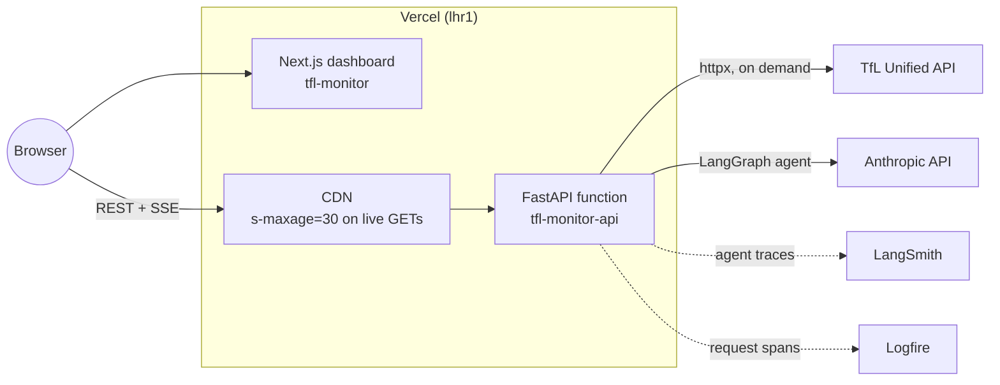

# tfl-monitor

> A data + AI engineering portfolio project: a live Transport for London
> monitor with a conversational agent. A stateless FastAPI function reads
> through to the TfL Unified API on demand, and a LangGraph agent answers
> questions about line status, disruptions, journeys, and arrivals with
> live TfL tools.

[](https://github.com/hcslomeu/tfl-monitor/actions/workflows/ci.yml)
[](https://hcslomeu.github.io/tfl-monitor/)
[](https://www.python.org/)
[](./LICENSE)

**Live in production:** `https://tfl-monitor.humbertolomeu.com` (dashboard)
and `https://tfl-monitor-api.humbertolomeu.com` (API + agent). Both run on
Vercel. See [ADR 015](./.claude/adrs/015-vercel-stateless-api.md).

- **Documentation**: <https://hcslomeu.github.io/tfl-monitor/>
- **Architecture**: [`ARCHITECTURE.md`](./ARCHITECTURE.md) ·
  [docs/architecture](https://hcslomeu.github.io/tfl-monitor/architecture/)
- **Setup**: [`SETUP.md`](./SETUP.md)
- **WP ledger**: [`PROGRESS.md`](./PROGRESS.md)

---

## What this project is

tfl-monitor shows the current state of the London network (Tube, Elizabeth
line, Overground, DLR) and lets you ask about it in plain English:

- **Dashboard.** Live line status and current or planned disruptions, polled
  every 30 seconds from the API, which reads TfL on each request.
- **Chat agent.** A LangGraph ReAct agent on Claude with four typed tools,
  all backed by live TfL calls:
  - `query_tube_status`: current status of every line.
  - `query_recent_disruptions`: active disruptions, optionally by mode.
  - `plan_journey_tool`: best route between two stations, rendered as a
    journey card.
  - `get_arrivals_tool`: next arrivals at a stop, rendered as an arrivals
    board.

Answers stream to the browser over Server-Sent Events, token by token, with
structured frames for the journey and arrivals cards.

## Why this project exists

A portfolio that demonstrates a production AI feature on a real public API,
not a notebook prototype:

- A typed contract (OpenAPI 3.1 + Pydantic v2) shared by backend and
  frontend, with CI gating drift.
- An agent that answers from live data through typed tools, never from
  memory, and degrades gracefully when TfL or the LLM fails.
- Serverless hosting with no server, database, or broker to operate, and
  hard spend caps on both compute and LLM tokens.
- End-to-end observability split between LangSmith (agent) and Logfire
  (application).

The project started with a much heavier design (a streaming ingestion
pipeline, a modelled warehouse, and retrieval over TfL strategy documents).
[ADR 014](./.claude/adrs/014-decommission-warehouse-live-proxy.md) and
[ADR 015](./.claude/adrs/015-vercel-stateless-api.md) record why it was cut
down to what the product actually needs.

## Architecture at a glance



- `GET /api/v1/status/live` and `GET /api/v1/disruptions/recent` read TfL
  live and are cached by the Vercel CDN for 30 seconds.
- `POST /api/v1/chat/stream` runs the agent and streams SSE frames.
- `GET /health` is a liveness probe that needs no secrets.

Request flows and the agent loop are described in
[`ARCHITECTURE.md`](./ARCHITECTURE.md).

## Tech stack

| Layer | Choice | Reason |
|-------|--------|--------|
| API | FastAPI + `sse-starlette` | Async, typed, SSE for the chat stream |
| TfL client | `httpx` + hand-rolled retry + Pydantic v2 | Async, typed tier-1 payloads, 429/5xx backoff |
| Agent | LangGraph 1.x `create_react_agent` | Tool-calling loop with in-process checkpointer |
| LLM | Anthropic Claude via `langchain-anthropic` (`claude-haiku-5-5` default) | Direct API, prompt caching, workspace spend limit |
| Contracts | OpenAPI 3.1 + Pydantic v2 | One source of truth for backend and frontend types |
| LLM observability | LangSmith | Traces every agent step and tool call |
| App observability | Logfire | OpenTelemetry-native FastAPI spans |
| Frontend | Next.js 16 + shadcn/ui | App Router, Tailwind v4, Radix Nova |
| Hosting | Vercel (Python function + Next.js) | Git-driven previews and production, CDN in front |
| Lint / format | Ruff (Python), Biome (TS) | One tool per ecosystem |
| Types / tests | Mypy strict, Pytest, Vitest | |

Full table with rationale in
[`docs/stack`](https://hcslomeu.github.io/tfl-monitor/stack/).

## Engineering highlights

### Contracts-first

Every cross-boundary shape lives in [`contracts/`](./contracts):
`openapi.yaml` for the HTTP API and Pydantic schemas for the TfL payloads
(tier-1, raw TfL camelCase) and the API responses (tier-2, flat
snake_case). The frontend generates `web/lib/types.ts` from the spec and CI
fails if it drifts; a backend test checks the FastAPI routes against the
spec in both directions.

### Live read-through, CDN-collapsed

There is no stored copy of TfL data. The two dashboard endpoints call TfL on
each miss and return `Cache-Control: public, s-maxage=30,
stale-while-revalidate=30`, so the CDN turns every viewer's 30-second poll
into at most one function run per window. Station names on disruption cards
resolve through cached TfL `/StopPoint` lookups.

### An agent wired to real data

The agent's four tools wrap the same live fetchers as the endpoints, so one
code path answers both the dashboard and the chat. Tool bodies catch
upstream errors and return a readable string instead of crashing the stream.
Journey and arrivals results are also emitted as structured SSE frames that
the frontend renders as cards (ADR 011).

### Bounded cost

The chat model runs with low effort, a 4096-token response cap, automatic
prompt caching, and a 12-step recursion limit per turn. The Anthropic key
comes from a dedicated Console workspace with a monthly spend limit; when it
is reached the stream tells the user the assistant is unavailable and the
dashboard keeps working.

### Observability split

- **LangSmith** answers *"why did the agent decide that?"*
- **Logfire** answers *"why is this endpoint slow?"*

Both run on hosted free tiers. No self-hosted telemetry.

## Local development

Prerequisites: `uv`, `pnpm`, Node 22, `make`, `git`. A free TfL API key and
an Anthropic API key; LangSmith and Logfire are optional. See
[`SETUP.md`](./SETUP.md) for details.

```bash
git clone git@github.com:hcslomeu/tfl-monitor.git
cd tfl-monitor
make bootstrap        # uv sync + pnpm install + create .env
# edit .env: TFL_APP_KEY, ANTHROPIC_API_KEY
make api              # FastAPI on http://localhost:8000 (loads .env)
```

In a second terminal:

```bash
NEXT_PUBLIC_API_URL=http://localhost:8000 pnpm --dir web dev   # http://localhost:3000
```

Checks:

```bash
uv run task lint      # ruff check + ruff format --check + mypy
uv run task test      # pytest (integration tests are opt-in)
make check            # Python lint + tests, then web lint + tests + build
```

### Documentation site

Local preview of the MkDocs Material site:

```bash
uv sync --group docs
uv run task docs-serve   # http://127.0.0.1:8001
```

The site is published to GitHub Pages on every merge to `main` via
`.github/workflows/docs.yml`.

## Production deployment

| Piece | Host |
|-------|------|
| API (`tfl-monitor-api`) | Vercel Python function, Fluid compute, Pro plan, region `lhr1` |
| Frontend (`tfl-monitor`) | Vercel Next.js project |
| LLM | Anthropic API, dedicated Console workspace with a monthly spend limit |
| DNS | Cloudflare (`humbertolomeu.com`, DNS only; Vercel terminates TLS) |
| Observability | LangSmith + Logfire free tiers |
| CI | GitHub Actions (`ci.yml`): lint, Bandit, tests, frontend build, OpenAPI type drift |
| CD | Vercel Git integration: a preview per branch, production on `main` |

The API entrypoint is `[tool.vercel] entrypoint = "src.api.main:app"` in
`pyproject.toml`; `vercel.json` pins the region, sets `maxDuration: 300` for
the SSE chat, and excludes non-runtime files from the bundle. Runbook in
[`SETUP.md`](./SETUP.md#deploy) and
[docs/deployment](https://hcslomeu.github.io/tfl-monitor/deployment/).

## Status

The app is live. Source of truth for the WP ledger is
[`PROGRESS.md`](./PROGRESS.md), mirrored in the
[docs roadmap](https://hcslomeu.github.io/tfl-monitor/roadmap/).

| Stage | Scope | Status |
|-------|-------|--------|
| Phases 0-7 | Original build: contracts, TfL client, API, agent, dashboard, first deploy | Done |
| ADR 014 | Live TfL proxy replaces the stored-feed pipeline | Done |
| ADR 015 | Stateless API on Vercel, Anthropic direct, live tools only | Done |

## Folder map

```text
tfl-monitor/
├─ contracts/        # OpenAPI 3.1 + Pydantic schemas (single source of truth)
├─ src/
│  ├─ api/           # FastAPI app, live TfL read-through, station resolver
│  │  └─ agent/      # LangGraph agent: graph, tools, prompts, SSE projection
│  ├─ ingestion/     # Async TfL client (httpx, retry, normalisers)
│  └─ common/        # Logfire sampling helper
├─ web/              # Next.js 16 + shadcn dashboard
├─ tests/            # Pytest suites (integration tests opt-in)
├─ scripts/          # TfL sample fetcher for fixtures
├─ docs/             # MkDocs Material site
├─ vercel.json       # API function config (region, maxDuration, excludes)
└─ .claude/          # ADRs, WP specs, napkin (coordination memory)
```

## Data sources and attribution

- **TfL Unified API**: live operational feeds. Powered by TfL Open Data.
  Contains OS data © Crown copyright and database rights.

No personal data is collected or stored by tfl-monitor. Chat messages are
held only in the function's memory for the life of the instance and are
traced in LangSmith.

## Licence

MIT. See [`LICENSE`](./LICENSE).

## Author

Built by **[Humberto Slomeu](https://github.com/hcslomeu)**, AI engineer
available for hire.
[LinkedIn](https://www.linkedin.com/in/hcslomeu/)
