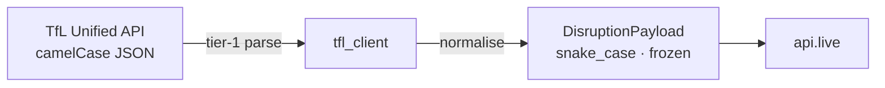

# contracts/

Single source of truth for every interface that crosses a service boundary.
**Changes here require an ADR in `.claude/adrs/` and a `contract:` PR.**

## What lives here

```text
contracts/
├─ openapi.yaml               # OpenAPI 3.1 spec: every HTTP endpoint
└─ schemas/                   # Pydantic v2
   ├─ tfl_api.py              # tier-1: raw TfL Unified API shapes
   ├─ disruptions.py          # normalised disruption payload
   └─ common.py               # shared enums (modes, severities, categories)
```

## Two tiers



| Tier | Where | Stability |
|------|-------|-----------|
| **Tier-1** | `schemas/tfl_api.py` | Optional-heavy; evolves at TfL's pace |
| **Normalised** | `schemas/disruptions.py` | Frozen; what `/api/v1/disruptions/recent` is built from |

Normalisation is `src/ingestion/tfl_client/normalise.py`. Synthetic SHA-256
IDs anchor disruptions whose upstream payload omits a stable identifier.
The Kafka event envelopes and the Postgres DDL were removed in ADR 014 and
ADR 015.

## CI invariants

| Drift gate | Mechanism |
|------------|-----------|
| `openapi.yaml` ↔ FastAPI routes | `tests/api/test_stubs.py` (both directions) |
| `openapi.yaml` ↔ `web/lib/types.ts` | `openapi-typescript` regenerated and diffed in CI |

## Changing the contract

1. `make openapi-ts` to re-emit `web/lib/types.ts` from the spec.
2. Write an ADR at `.claude/adrs/NNN-title.md` explaining the change.
3. Prefix the PR title with `contract:` so reviewers know to look.
