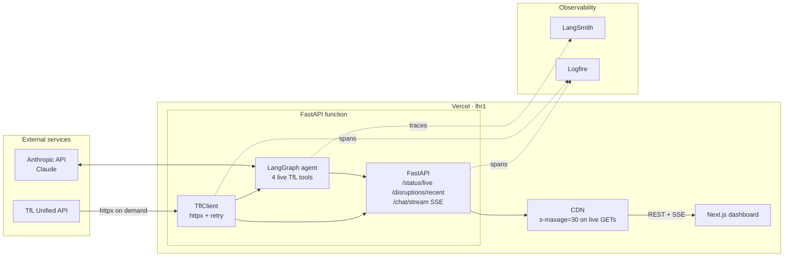
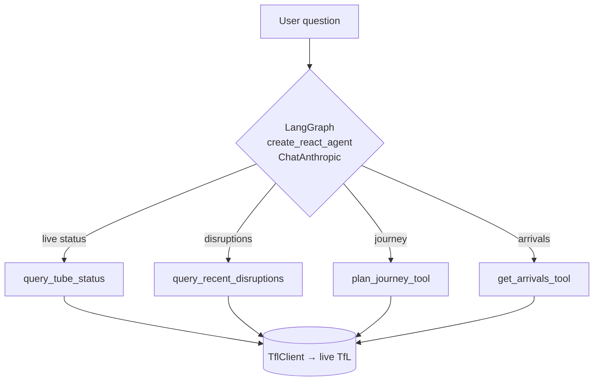
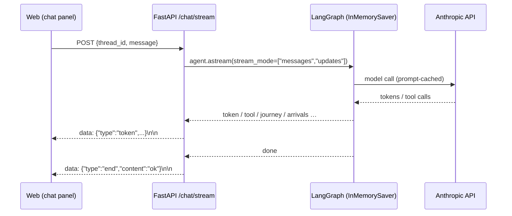
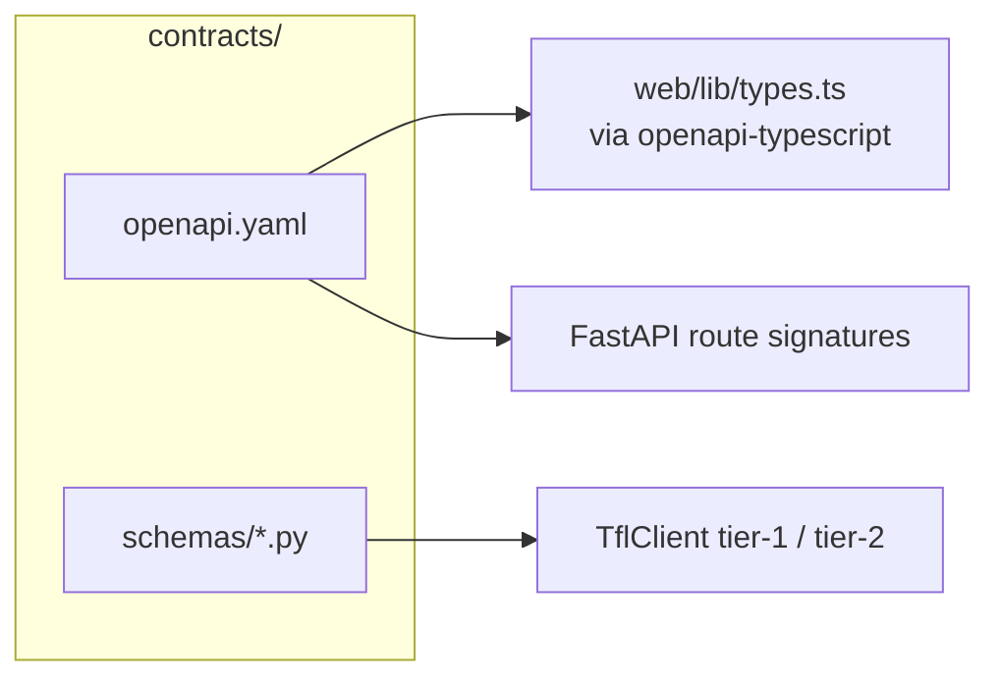

# Architecture

A bird's-eye view of how a request flows from the dashboard to TfL and back,
with every component pinned to a directory in the repo. The app is a **live TfL
proxy + chat agent**: a stateless FastAPI function on Vercel reads through to
TfL on demand and serves a LangGraph agent whose tools all call TfL live
(ADR 014, ADR 015). There is no database, no broker, and no document store.

## System diagram

## Component-to-directory map

| Layer | Directory | Runtime |
|-------|-----------|---------|
| Async TfL client | [`src/ingestion/tfl_client/`](https://github.com/hcslomeu/tfl-monitor/tree/main/src/ingestion/tfl_client) | Python 3.12 · httpx |
| Read-through endpoints | [`src/api/live.py`](https://github.com/hcslomeu/tfl-monitor/blob/main/src/api/live.py) | FastAPI |
| Station resolver | [`src/api/stations.py`](https://github.com/hcslomeu/tfl-monitor/blob/main/src/api/stations.py) | Cached TfL `/StopPoint` lookups |
| Agent | [`src/api/agent/`](https://github.com/hcslomeu/tfl-monitor/tree/main/src/api/agent) | LangGraph + `ChatAnthropic` |
| API | [`src/api/`](https://github.com/hcslomeu/tfl-monitor/tree/main/src/api) | FastAPI + sse-starlette on Vercel |
| Frontend | [`web/`](https://github.com/hcslomeu/tfl-monitor/tree/main/web) | Next.js 16 + shadcn on Vercel |
| Contracts | [`contracts/`](https://github.com/hcslomeu/tfl-monitor/tree/main/contracts) | OpenAPI + Pydantic |
| Deploy config | [`vercel.json`](https://github.com/hcslomeu/tfl-monitor/blob/main/vercel.json) + `pyproject.toml` `[tool.vercel]` | Vercel Git integration |

## Data flow walkthrough

### 1. The API reads TfL on demand

`/status/live` and `/disruptions/recent` call `TflClient` directly
(`src/api/live.py`), normalise the tier-1 payload into the tier-2 response
shape, and return it with `Cache-Control: public, s-maxage=30,
stale-while-revalidate=30`. The Vercel CDN serves repeat polls inside each
30-second window, so many viewers cost at most one function run. Nothing is
persisted; an upstream failure surfaces as RFC 7807 `502`. See
[Live TfL proxy](pipelines/ingestion.md).

### 2. Station names resolve live

Disruption payloads carry NaPTAN codes. `src/api/stations.py` resolves them
to station names through TfL `/StopPoint/{id}` lookups, with a
process-lifetime cache that stores only confirmed results.

### 3. The agent fans out across four live tools

The tools register only when a `TflClient` is wired. `compile_agent` returns
`None` when `ANTHROPIC_API_KEY` is missing, so `/chat/stream` returns `503`
while the live endpoints keep working. See [LangGraph agent](pipelines/agent.md).

### 4. SSE projection over LangGraph events

Conversation memory lives in the agent's in-process `InMemorySaver`, keyed by
`thread_id`. A cold start or a request routed to another function instance
starts the thread fresh. If Anthropic rejects the call (spend limit, auth,
rate limit), the stream sends a readable token and then `end: "error"`.

## Contracts

`contracts/` is the single source of truth for every cross-service interface:

Two tiers of Pydantic schemas separate the messy outside world from the clean
internal shape. See [tier-1 vs tier-2](pipelines/ingestion.md#contracts).

## Related ADRs

The cross-cutting decisions worth a paper trail (full set under
[`.claude/adrs/`](https://github.com/hcslomeu/tfl-monitor/tree/main/.claude/adrs)):

- [002: Contracts-first parallelism](https://github.com/hcslomeu/tfl-monitor/blob/main/.claude/adrs/002-contracts-first.md)
- [004: Logfire + LangSmith split](https://github.com/hcslomeu/tfl-monitor/blob/main/.claude/adrs/004-logfire-langsmith-split.md)
- [007: Disruption affected-stops shape](https://github.com/hcslomeu/tfl-monitor/blob/main/.claude/adrs/007-disruption-affected-stops-shape.md)
- [010: TfL hub → rail-child dereference](https://github.com/hcslomeu/tfl-monitor/blob/main/.claude/adrs/010-tfl-hub-children.md)
- [011: Structured journey/arrivals SSE frames](https://github.com/hcslomeu/tfl-monitor/blob/main/.claude/adrs/011-structured-journey-arrivals-sse-frames.md)
- [014: Decommission the warehouse → live proxy](https://github.com/hcslomeu/tfl-monitor/blob/main/.claude/adrs/014-decommission-warehouse-live-proxy.md) *(supersedes 001 + 005)*
- [015: Stateless API on Vercel](https://github.com/hcslomeu/tfl-monitor/blob/main/.claude/adrs/015-vercel-stateless-api.md) *(supersedes 006 + 013)*
