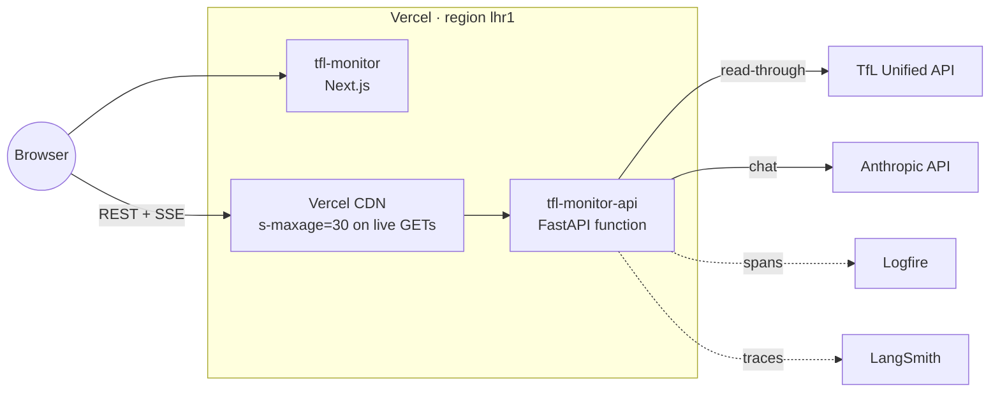

# Deployment

Both halves of the app run on **Vercel**. The API is a stateless FastAPI
function (Fluid compute, Pro plan, region `lhr1`) and the dashboard is a
Next.js project. There is no server, database, broker, or AWS resource to
operate (ADR 015).

## Projects

| Project | What it serves | Public URL |
|---------|----------------|------------|
| `tfl-monitor-api` | FastAPI (`src/api/main.py`), Python runtime | `https://tfl-monitor-api.humbertolomeu.com` |
| `tfl-monitor` | Next.js dashboard (`web/`) | `https://tfl-monitor.humbertolomeu.com` |

The frontend reaches the API through `NEXT_PUBLIC_API_URL`. The API's CORS
allowlist pins the production origins plus an anchored regex for
`tfl-monitor-*.vercel.app` preview deployments.

## Topology



## How the API is built

| File | Setting |
|------|---------|
| `pyproject.toml` | `[tool.vercel] entrypoint = "src.api.main:app"` |
| `vercel.json` | `regions: ["lhr1"]`; `maxDuration: 300` for the SSE chat; `excludeFiles` drops `.claude/`, `.github/`, `docs/`, `scripts/`, `tests/`, `web/` and Markdown from the bundle |

Vercel installs the runtime dependencies from `uv.lock`. Without the RAG,
Postgres, and AWS libraries the unzipped bundle is about 100 MB.

## How a deploy happens

Vercel's Git integration builds every push:

- **Branch push or PR:** a preview deployment on a `*.vercel.app` URL.
- **Merge to `main`:** a production deployment, aliased to the custom domains.

There is no deploy workflow in GitHub Actions and no SSH step. CI
(`ci.yml`) runs lint and tests; Vercel does the build and release.

## Environment variables

Set on the `tfl-monitor-api` project (Production and Preview):

| Variable | Required | Purpose |
|----------|----------|---------|
| `TFL_APP_KEY` | yes | TfL Unified API key. Unset means `/status/live` and `/disruptions/recent` return `503` |
| `ANTHROPIC_API_KEY` | yes | Chat model. Unset means `/chat/stream` returns `503` |
| `CHAT_MODEL` | no | Overrides the default `claude-haiku-5-5` without a code change |
| `LOGFIRE_TOKEN` | no | Enables Logfire export; without it Logfire runs as a no-op |
| `LANGSMITH_TRACING` | no | `true` to send agent traces |
| `LANGSMITH_API_KEY` | no | LangSmith key |
| `LANGSMITH_PROJECT` | no | `tfl-monitor` |
| `ENVIRONMENT` | no | Logfire environment tag (e.g. `production`) |
| `APP_VERSION` | no | Logfire service version tag |

The `tfl-monitor` frontend project only needs `NEXT_PUBLIC_API_URL`.

## DNS

The domain lives on Cloudflare. A CNAME record `tfl-monitor-api` points to
Vercel and is **DNS only** (grey cloud): Vercel terminates TLS and issues the
certificate. The frontend hostname `tfl-monitor` follows the same pattern.

## CDN caching

`GET /api/v1/status/live` and `GET /api/v1/disruptions/recent` return:

```text
Cache-Control: public, s-maxage=30, stale-while-revalidate=30
```

The dashboard polls every 30 seconds per viewer. The Vercel CDN collapses
those requests into at most one function run per 30-second window, so viewer
count does not drive TfL calls or function invocations. `/chat/stream` is a
`POST` and is never cached.

## Spend caps

| Cost | Guard |
|------|-------|
| Vercel usage (function time, bandwidth) | Vercel Spend Management limit on the team |
| LLM tokens | The API key comes from a dedicated Anthropic Console workspace with a monthly spend limit |

When Anthropic rejects a call (spend limit reached, auth, rate limit), the
chat stream emits a readable token explaining the assistant is unavailable,
then `end: "error"`. The live dashboard keeps working.

## Operations

| Action | How |
|--------|-----|
| Public smoke | `curl -fsS https://tfl-monitor-api.humbertolomeu.com/health` |
| Check CDN caching | `curl -sS -D - -o /dev/null https://tfl-monitor-api.humbertolomeu.com/api/v1/status/live` (a GET; the route answers HEAD with 405) and look for `x-vercel-cache` |
| Function logs | Vercel dashboard, `tfl-monitor-api` project, Logs tab |
| Run the API locally | `make api` (uvicorn with `.env` loaded) |

## Rollback

1. **Instant rollback:** promote a previous production deployment from the
   Vercel dashboard (or `vercel rollback`).
2. **Per-PR:** `git revert -m 1 <merge-sha>`; the next push to `main` deploys.
3. **Model change:** set `CHAT_MODEL` and redeploy; no code change needed.

## History

The API previously ran as a Docker container on a shared AWS Lightsail box
behind Caddy, with AWS Bedrock for the LLM and Supabase Postgres for pgvector
and reference data (ADR 006). ADR 015 replaced all of that with the Vercel
function above.
