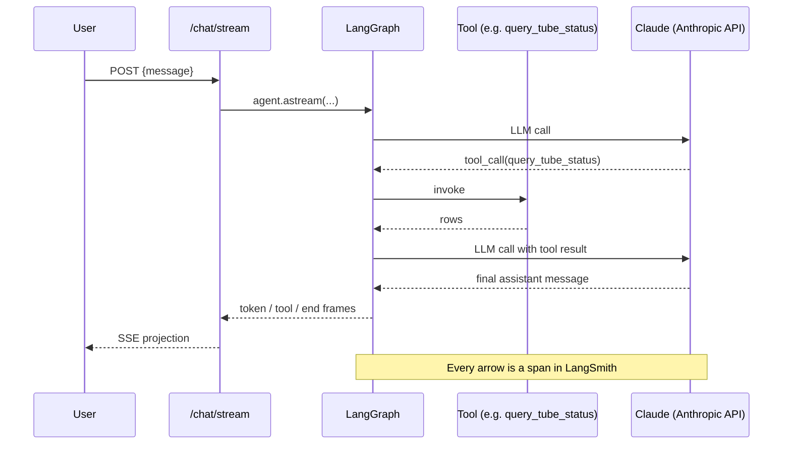

# Observability

Two hosted tools, clearly separated by concern. No self-hosted telemetry stack.

```mermaid
flowchart LR
    subgraph SRC[Sources of telemetry]
      API[FastAPI handlers]
      AGENT[LangGraph agent]
      HTTP[TflClient → TfL Unified API]
    end

    subgraph TELEMETRY[Telemetry collectors]
      LF[Logfire<br/>OpenTelemetry-native]
      LS[LangSmith<br/>LangChain-native]
    end

    API -.request spans.-> LF
    HTTP -.tfl.request spans.-> LF
    AGENT -.agent.tool.* spans.-> LF
    AGENT -.LLM + tool + node traces.-> LS
```

## What goes where

| Question | Tool |
|----------|------|
| How did the agent arrive at that answer? | **LangSmith** |
| Which tool did the agent pick, and with what arguments? | **LangSmith** |
| How many tokens did this conversation cost, and how much was cached? | **LangSmith** |
| Which TfL endpoint is throttling us with 429s? | **Logfire** |
| Why is `/disruptions/recent` p99 latency high? | **Logfire** |
| How long did the upstream TfL call take? | **Logfire** |
| Did a chat stream end because Anthropic rejected the call? | **Logfire** (`chat_llm_rejected`) |

The split is captured formally in [ADR 004: Logfire + LangSmith
split](https://github.com/hcslomeu/tfl-monitor/blob/main/.claude/adrs/004-logfire-langsmith-split.md).

## Logfire wiring

Initialised once in `src/api/observability.py`:

```python
logfire.configure(
    service_name="tfl-monitor-api",
    service_version=os.getenv("APP_VERSION", "0.0.1"),
    environment=os.getenv("ENVIRONMENT", "local"),
    send_to_logfire="if-token-present",
    sampling=build_sampling_options(0.1),
)
logfire.instrument_fastapi(app)
```

What this gives us:

- One span per FastAPI request, with route + status + duration.
- One `tfl.request` span per outbound TfL call, emitted by `TflClient`, with
  the path and parameters (`app_key` replaced by `***`).
- Structured events via `logfire.info(...)` / `logfire.exception(...)` rather
  than `print()` or bare `logging`.

Without `LOGFIRE_TOKEN` Logfire runs as a no-op, so local runs and tests need
no credentials. `LOGFIRE_SAMPLE_RATE` overrides the default 10% head sampling.

### Service boundaries traced

| Span namespace | Code path |
|----------------|-----------|
| `tfl-monitor-api` | FastAPI request handlers |
| `tfl.request` | TfL Unified API calls from `TflClient` |
| `agent.tool.*` | LangGraph tool invocations (status, disruptions, journey, arrivals) |

## LangSmith wiring

Set three env vars and LangGraph auto-instruments:

```bash
LANGSMITH_TRACING=true
LANGSMITH_API_KEY=ls__...
LANGSMITH_PROJECT=tfl-monitor
```

What this gives us out of the box:

- One trace per `/chat/stream` invocation.
- One span per LangGraph node and per tool call within the trace.
- Token counts per call, including prompt-cache reads, per turn and per
  session.

### Trace shape



## What we explicitly do not do

!!! danger "No custom observability"
    The `CLAUDE.md` policy forbids:

    - Prometheus / Grafana / Loki / Jaeger / OpenTelemetry collector sidecars.
    - Custom structured-logging wrappers around `logging`.
    - Custom token-cost dashboards.
    - Per-route metric emitters that duplicate what Logfire already captures.

    Two free-tier hosted tools are sufficient for a portfolio project. They
    also degrade gracefully: code paths still run if the tokens are missing.

## Cost

Both Logfire and LangSmith free tiers cover this project comfortably.

| Tool | Free tier | Project usage |
|------|-----------|---------------|
| Logfire | 10 GB ingest / month | <500 MB at portfolio cadence |
| LangSmith | 5 k traces / month, 14-day retention | <1 k traces / month |

LLM spend itself is capped by the Anthropic workspace limit, not by
observability (see [Deployment](deployment.md#spend-caps)).
