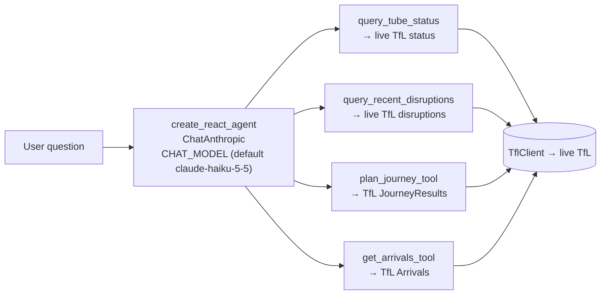
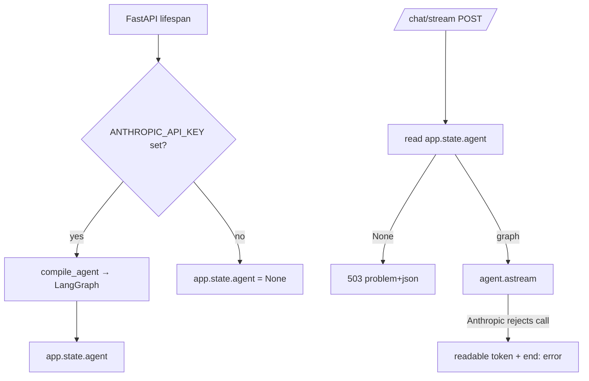

# LangGraph agent

A `create_react_agent` over **four typed tools**, all backed by live TfL calls:
line status, disruptions, journey planning, and arrivals. The model is Claude
via the Anthropic API, and the answer streams to the browser over SSE.

## Code map

| Concern | Module |
|---------|--------|
| Graph compilation + model config | `src/api/agent/graph.py` |
| Tool definitions | `src/api/agent/tools.py` |
| System prompt | `src/api/agent/prompts.py` |
| SSE projection | `src/api/agent/streaming.py` |
| Station name → NaPTAN search | `src/api/stations.py` (`resolve_name`) |
| FastAPI route | `src/api/main.py` (`/chat/stream`) |

## Tool surface



`make_tools` registers the four tools only when a `TflClient` is wired
(graceful degradation when `TFL_APP_KEY` is unset). Each tool takes a typed
Pydantic `args_schema`, so the model cannot call it with malformed arguments.
The journey and arrivals tools first resolve free-text station names through
TfL `/StopPoint/Search` (cached per process).

Every `TflClient` call inside a `@tool` body is wrapped in `try/except`
returning a friendly string: LangGraph re-raises non-`ToolException` errors
and would otherwise crash the stream (ADR 010). Tool docstrings declare
assumptions that should reach the model (e.g. journey endpoints deref a hub id
to its rail child).

## Model configuration

`_build_chat_model` in `graph.py` builds one `ChatAnthropic` client:

| Setting | Value | Why |
|---------|-------|-----|
| Model | `CHAT_MODEL`, default `claude-haiku-5-5` | Change the model without a code change |
| Effort | `low` | Short tool-routing answers do not need deep reasoning |
| Max tokens | 4096 | Bounds the cost of a runaway turn |
| Prompt caching | `cache_control: ephemeral` | System prompt and tool schemas repeat on every request |
| Recursion limit | 12 LangGraph super-steps per turn | Roughly five tool calls, then stop |
| Timeout | 60 s | Fails fast instead of holding the function open |

No sampling parameters are set (current models reject them). Spend is capped
outside the code: `ANTHROPIC_API_KEY` is issued from a dedicated Anthropic
Console workspace with a monthly spend limit.

## Graceful degradation



`compile_agent` returns `None` when `ANTHROPIC_API_KEY` is missing, so a
deploy without it still serves the live status and disruption views; only
`/chat/stream` returns `503`. When Anthropic rejects a call mid-stream (spend
limit reached, auth, rate limit), the route emits a token saying the assistant
is unavailable and then `end: "error"`.

## SSE projection

LangGraph emits two stream channels: `messages` (token-level deltas) and
`updates` (tool calls + state changes). `streaming.project` collapses them into
the frame format the browser consumes. On a `plan_journey_tool` /
`get_arrivals_tool` result it emits a structured `journey` / `arrivals` frame so
the frontend can render a rich card instead of prose (ADR 011):

```text
{type: "token"   | content: "..."}        # streamed answer text
{type: "tool"    | content: "query_tube_status"}
{type: "journey" | content: <JourneyView JSON>}
{type: "arrivals"| content: <ArrivalsView JSON>}
{type: "end"     | content: "ok" | "error"}
```

The frame set is the **stable contract** between the agent runtime and the
frontend; swapping LangGraph for another framework only needs to keep it intact.

## Conversation memory

Memory lives in the agent's in-process `InMemorySaver`, keyed by `thread_id`.
Nothing is persisted. On Vercel a cold start, or a request routed to another
function instance, starts the thread fresh; that is acceptable at portfolio
traffic (ADR 015). There is no history endpoint.

## Tests

| Suite | Coverage |
|-------|----------|
| `tests/agent/test_live_tools.py` | Status + disruptions tools: happy path, empty, upstream-failure swallow |
| `tests/agent/test_journey_tools.py` | Journey + arrivals tools: name resolution, departure-time parsing, failures |
| `tests/agent/test_graph_compile.py` | Compile, no API key, default model and `CHAT_MODEL` override |
| `tests/agent/test_prompts.py` | System prompt rendering |
| `tests/api/test_chat_stream.py` | SSE happy path, 503 no agent, mid-stream `end:error`, Anthropic rejection message, journey/arrivals frames |
| `tests/integration/test_chat_stream.py` | Live chat stream (opt in with `-m integration`) |
