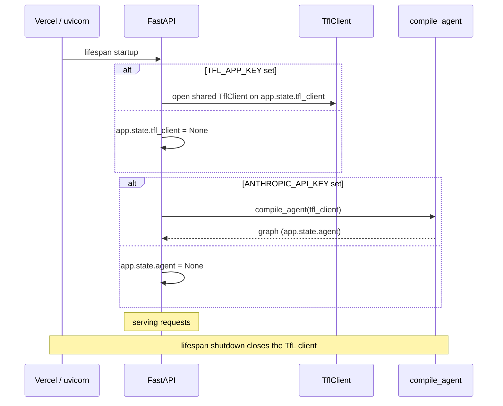
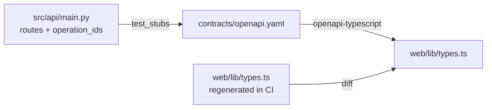

# FastAPI surface

Four endpoints, RFC 7807 errors, no database, and **OpenAPI 3.1 as the
contract**: the frontend regenerates types from it. The app runs as a
stateless function on Vercel (ADR 015).

## Code map

| Concern | Module |
|---------|--------|
| Application, lifespan, route handlers | `src/api/main.py` |
| Live TfL read-through | `src/api/live.py` |
| Station resolver (cached TfL `/StopPoint`) | `src/api/stations.py` |
| Pydantic response models | `src/api/schemas.py` |
| Logfire wiring | `src/api/observability.py` |
| Agent compilation | `src/api/agent/` |
| Optional TfL debug router (local only, `TFL_DEBUG_PROXY=1`) | `src/api/debug_tfl.py` |

## Endpoints

| Method | Path | Source | Notes |
|--------|------|--------|-------|
| `GET` | `/health` | static | Liveness probe |
| `GET` | `/api/v1/status/live` | live TfL `/Line/Mode/{modes}/Status` | One status row per line; CDN-cached 30 s |
| `GET` | `/api/v1/disruptions/recent` | live TfL `/Line/Mode/{modes}/Status?detail=true` | `?limit=50&mode=tube`; affected stops resolved to names; CDN-cached 30 s |
| `POST` | `/api/v1/chat/stream` | LangGraph agent | SSE: `{type, content}` frames |

The `/status/live` and `/disruptions/recent` handlers call `TflClient` directly
(`src/api/live.py`). Successful responses carry
`Cache-Control: public, s-maxage=30, stale-while-revalidate=30`, so the Vercel
CDN answers repeat polls without running the function. Error responses are
never cached. See [Live TfL proxy](ingestion.md).

`GET /api/v1/chat/{thread_id}/history` was removed in ADR 015 together with
the chat log table it read.

## Lifespan



Each handler reads `app.state.tfl_client` / `app.state.agent` and returns a
problem+json error if a dependency is missing, so `make check` and unit tests
run without any external services. The agent module is imported lazily inside
the lifespan to keep cold-start imports small.

## Error contract

Every error response is `application/problem+json`:

```json
{
  "type": "about:blank",
  "title": "Bad Gateway",
  "status": 502,
  "detail": "Failed to fetch live status from TfL"
}
```

The `_problem` helper in `src/api/main.py` wraps the documented surfaces:

| Status | When |
|--------|------|
| 422 | Pydantic validation failure (FastAPI default) |
| 502 | Upstream TfL request failed |
| 503 | TfL client unset (no `TFL_APP_KEY`) or agent unset (no `ANTHROPIC_API_KEY`) |

Errors inside an open chat stream cannot change the HTTP status, so they end
the stream with `{"type": "end", "content": "error"}` instead. An Anthropic
rejection (spend limit, auth, rate limit) first sends a readable token.

## CORS

The allowlist pins `http://localhost:3000`, `https://tfl-monitor.vercel.app`,
and `https://tfl-monitor.humbertolomeu.com`, plus an anchored regex for
`tfl-monitor-*.vercel.app` preview deployments. Methods are limited to `GET`,
`POST`, and `OPTIONS`.

## OpenAPI 3.1 as the source of truth

The committed contract lives at
[`contracts/openapi.yaml`](https://github.com/hcslomeu/tfl-monitor/blob/main/contracts/openapi.yaml)
and two checks keep it honest:

- `tests/api/test_stubs.py` asserts every app route has a matching spec
  entry (by `operation_id`) and every spec operation has a route.
- CI regenerates `web/lib/types.ts` from the contract and `diff`s it against
  the committed file.



So adding a route involves three pinned files: the Pydantic schema, the OpenAPI
entry, and the TypeScript types. Drift in any direction breaks CI.

## Observability

Configured once in `src/api/observability.py`:

```python
logfire.configure(
    service_name="tfl-monitor-api",
    send_to_logfire="if-token-present",
    ...
)
logfire.instrument_fastapi(app)
```

Per-request spans cover route + status + latency; `TflClient` emits a
`tfl.request` span per outbound TfL call (`app_key` redacted). LangSmith
captures the agent traces. See [Observability](../observability.md).

## Tests

| Suite | Notable |
|-------|---------|
| `tests/test_health.py` | `/health` returns ok |
| `tests/api/test_stubs.py` | Routes and OpenAPI operations match both ways |
| `tests/api/test_status_live.py` | Happy path, `Cache-Control` header, empty result, `503` without client, `502` on upstream failure |
| `tests/api/test_disruptions_recent.py` | Limit + mode params, `422` on bad input, station-name resolution, no cache header on errors |
| `tests/api/test_stations.py` | `/StopPoint` resolution, confirmed-miss cache, no cache-poison on transient failures, hub deref |
| `tests/api/test_cors.py` | Pinned origins + anchored Vercel-preview regex, attacker-origin reject |
| `tests/api/test_chat_stream.py` | SSE happy path, 503 no agent, mid-stream `end:error`, Anthropic rejection message, journey/arrivals frames |
| `tests/api/test_lazy_imports.py` | Importing `api.main` does not load the agent stack eagerly |

`TflClient` calls are faked in unit tests: no TfL or Anthropic dependency in
the default suite.
