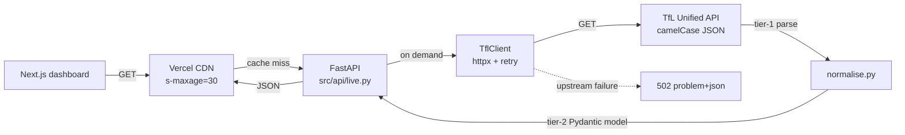
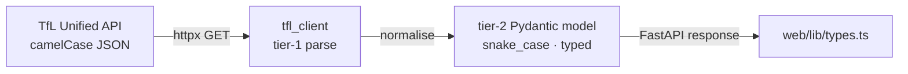

# Live TfL proxy

The app reads through to the **TfL Unified API on demand**. There is no broker,
no feed warehouse, and no database (ADR 014, ADR 015). A request to
`/status/live` or `/disruptions/recent` triggers an async HTTP call to TfL,
normalises the response with Pydantic v2, and returns it. Nothing is persisted.

## Code map

| Concern | Module |
|---------|--------|
| Async HTTP client to TfL | `src/ingestion/tfl_client/client.py` |
| Hand-rolled retry (429 / 5xx / timeout) | `src/ingestion/tfl_client/retry.py` |
| Tier-1 → tier-2 normalisation | `src/ingestion/tfl_client/normalise.py` |
| Read-through endpoint handlers | `src/api/live.py` |
| NaPTAN ↔ station-name resolver | `src/api/stations.py` |

## Read-through flow

| Endpoint | TfL call | Notes |
|----------|----------|-------|
| `GET /api/v1/status/live` | `/Line/Mode/{modes}/Status` | One status row per line |
| `GET /api/v1/disruptions/recent` | `/Line/Mode/{modes}/Status?detail=true` | Walks `Line → lineStatuses[] → disruption` |

`?detail=true` is deliberate: the free-tier `/Disruption` endpoint returns empty
`affectedRoutes` / `affectedStops`, whereas the detailed status response carries
the populated fan-out (ADR 007). When TfL fails or times out, the handler
returns RFC 7807 `502` rather than a stale or empty body.

Successful responses carry `Cache-Control: public, s-maxage=30,
stale-while-revalidate=30`. The dashboard polls every 30 seconds, so the CDN
turns any number of viewers into at most one TfL round trip per window.

## Contracts

Tier-1 is the wire format from TfL: messy, optional-heavy, evolving at TfL's
pace (`contracts/schemas/tfl_api.py`). Tier-2 is the flat, typed shape the API
returns, pinned by `contracts/openapi.yaml`. The normalisation step lives in
`tfl_client/normalise.py`; synthetic SHA-256 IDs anchor disruptions whose
upstream payload omits a stable identifier.

## Resilience

`TflClient` wraps every call in a hand-rolled retry policy:

- **429:** honour `Retry-After`, exponential backoff.
- **5xx / timeout:** bounded retries, then surface the failure as `502`.
- **`app_key` redaction:** the TfL key is replaced with `***` in the
  `tfl.request` Logfire span attributes.

Inside the agent, every `TflClient` call in a `@tool` body is additionally
wrapped in `try/except` returning a friendly string: LangGraph re-raises
non-`ToolException` errors and would otherwise crash the chat stream (ADR 010).

## Station resolution

`src/api/stations.py` turns the NaPTAN codes in a disruption payload into
human-readable station names through TfL `/StopPoint/{naptan_id}` lookups. A
process-lifetime cache stores only confirmed results (a name, or a definitive
404) so a transient TfL hiccup never poisons it, and a semaphore bounds
concurrent lookups to stay inside the TfL rate limit. The reverse direction
(`resolve_name`, free text → NaPTAN via `/StopPoint/Search`) serves the journey
and arrivals tools, with hub ids dereferenced to their rail child (ADR 010).

Before ADR 015 a dbt-built `dim_stations` table was the fast path; the live
lookup was already the fallback, so it became the only path.

## Tests

| Layer | Coverage |
|-------|----------|
| `tests/ingestion/test_tfl_client.py` | Retry on 429 / 5xx / timeout, `app_key` redaction |
| `tests/ingestion/test_normalise.py` | Tier-1 → tier-2 mapping, synthetic-ID stability |
| `tests/api/test_status_live.py`, `test_disruptions_recent.py` | Happy path, empty, `502` on upstream failure, cache header |
| `tests/api/test_stations.py` | `/StopPoint` resolution, confirmed-404 cache, no cache-poison on 5xx |

All fixtures live under `tests/fixtures/tfl/`: production code never hits the
live TfL API in the default test suite.
