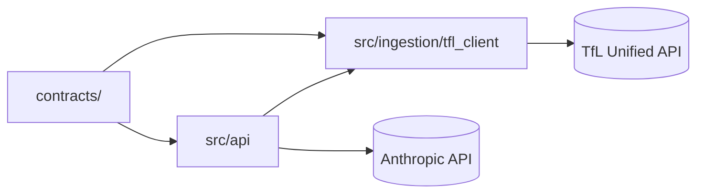

# src/

Python source: three packages, one wheel target. Every cross-package
interface flows through `contracts/`; nothing in `src/` defines its own TfL
DTOs.

## Packages

| Path | Purpose |
|------|---------|
| [`api/`](./api) | FastAPI app, live TfL endpoints, LangGraph chat agent |
| [`ingestion/`](./ingestion) | Async TfL Unified API client the API reads live |
| [`common/`](./common) | Shared Logfire sampling options |



There is no database (ADR 015): the API is stateless.

## Build

A single `pyproject.toml` at the repo root drives everything. The wheel
packages these directories, and Vercel installs it from `uv.lock`:

```toml
[tool.hatch.build.targets.wheel]
packages = ["src/common", "src/ingestion", "src/api", "contracts"]
```

Pytest adds `src/` to `sys.path` via the ini option, so imports look like
`from api.main import app`, not `from src.api.main`.

## Running

```bash
uv run task api        # FastAPI on :8000
make api               # same, with .env loaded
```

## Lint + types

Ruff and Mypy strict run across `src/` and `contracts/`:

```bash
uv run task lint   # ruff check + ruff format --check + mypy src contracts
```

`scripts/` is excluded from Mypy (one-off scripts; type discipline kicks in
at the package boundary).
